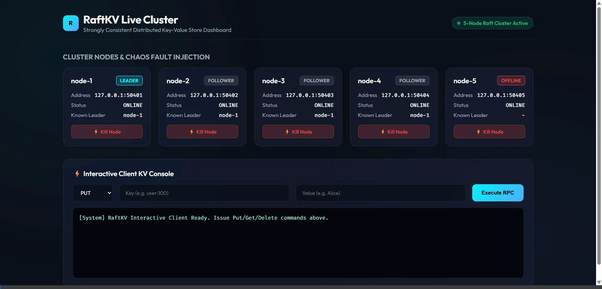
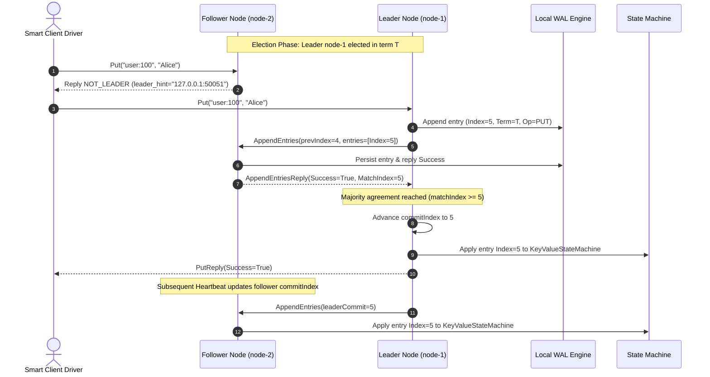

# RaftKV — Raft-Replicated Key-Value Store in Python

[](https://github.com/Charanloyal/raftkv/actions)


`RaftKV` is a key-value store replicated across a 5-node cluster by a from-scratch implementation of the **Raft consensus algorithm** (Ongaro & Ousterhout), written in Python 3.11+ with `asyncio` and gRPC/Protobuf. It covers leader election, log replication, SQLite-backed persistence of Raft state, threshold-based snapshots with `InstallSnapshot`, and a client that follows leader hints and tags writes with per-client sequence numbers for retry deduplication.

**Status: experimental / learning implementation.** The core election and replication paths pass the in-process 5-node tests in CI, but several properties needed for production use are not implemented or have known bugs — reads are not linearizable, there is no membership change, and the audit found correctness issues listed under [Known limitations](#known-limitations). No benchmark or chaos-run output is committed.



---

## 🏗 Architecture Overview

Each node runs one `RaftEngine` (`raftkv/consensus/engine.py`) behind a gRPC server (`raftkv/server.py`) that exposes two services from `proto/raft.proto`: `RaftConsensus` (`RequestVote`, `AppendEntries`, `InstallSnapshot`) between nodes, and `ClientService` (`Put`, `Get`, `Delete`) for clients. Raft persistent state (`currentTerm`, `votedFor`, log entries, snapshot metadata) is stored in SQLite (`journal_mode=WAL`, `synchronous=FULL`); the key-value state machine is an in-memory dict that is periodically snapshotted to `snapshot.json`. Peer membership is a static list passed at start-up.

The write path below is what the code does. Reads (`Get`) do **not** go through the log — see [Consistency guarantees](#consistency-guarantees).



---

## 🚀 What Is Implemented

1. **Consensus core** (`raftkv/consensus/engine.py`): follower/candidate/leader roles; randomized 150–300 ms election timeouts; 50 ms leader heartbeats; `RequestVote` with the log up-to-date check; `AppendEntries` consistency check with conflict-index backtracking and truncation of conflicting suffixes; commit only of current-term entries once a majority `matchIndex` reaches them; a `NOOP` entry appended on election.
2. **Persistence** (`raftkv/storage/wal.py`): SQLite database per node (`wal_<node_id>.sqlite`, `journal_mode=WAL`, `synchronous=FULL`, so each committed transaction is fsync'd) holding `currentTerm`, `votedFor`, log entries and snapshot metadata. State is reloaded on restart.
3. **Snapshots** (`raftkv/storage/snapshot.py`): when the in-memory log reaches 50 entries, the state machine (key-value map + per-client sequence table) is written to `snapshot.json` via temp file + `fsync` + `os.replace`, and the log prefix is deleted from SQLite. Followers that are behind the leader's compacted prefix receive the whole snapshot in one `InstallSnapshot` RPC.
4. **Client** (`raftkv/client.py`): `RaftKVClient` follows `NOT_LEADER` redirect hints, rotates through the configured addresses on connection errors, and retries with fixed 0.2–0.3 s pauses (no exponential backoff). Writes carry `(client_id, sequence_num)`; the state machine skips a write whose sequence number is ≤ the highest one already applied for that client.
5. **Cluster tooling**: `docker-compose.yml` runs five containers on a Docker bridge network. The automated failover scenarios (`tests/`, `chaos_runner.py`) instead run five nodes as asyncio tasks in a single Python process on loopback and "crash" a node by cancelling its task.
6. **Web demo** (`web_demo.py`): an in-process 5-node cluster with an HTTP dashboard (per-node role, status and known leader, kill/start buttons, KV console) and a plain-text `/metrics` endpoint (node online/leader gauges, operation count, average latency of the last 20 dashboard operations).
7. **Docs**: [PRD](docs/PRD.md) and [architecture notes](docs/ARCHITECTURE.md). The PRD lists targets; its implementation-status section records which are not met.

---

## Consistency guarantees

- **Writes** (`Put`/`Delete`) are acknowledged after the entry is committed on a majority and applied on the leader.
- **Reads** (`Get`) are served from the leader's local state machine after the node checks only that *it believes* it is leader. There is no ReadIndex, lease, or quorum round-trip, and a leader cut off from the majority does not step down until it hears a higher term. **Reads can therefore be stale; they are not linearizable.**
- **Deduplication** is at-most-once application of a retried write, assuming each client has one request outstanding at a time. Responses are not cached, so it is not exactly-once. If one `RaftKVClient` issues concurrent writes and a higher sequence number commits first, the lower one is skipped but still reported as successful.
- **Membership** is static (peer list from `--peers` / `PEER_ADDRESSES`); joint consensus and single-server membership changes are not implemented.

---

## Known limitations

Found during a code audit and reproduced with unit-level probes against `RaftEngine` / `KeyValueStateMachine` (no network):

1. **A deposed leader can acknowledge a write that was never committed.** Pending client requests are keyed by log index only. If a leader loses leadership and the new leader commits a different entry at that index, the old leader's waiting `Put` is completed with `success=True`. Fix: store the term with each pending request and fail it on mismatch or on step-down.
2. **A candidate can vote twice in one term.** `handle_append_entries` clears `votedFor` when a candidate receives `AppendEntries` for its *current* term, after which it can grant a second vote in that term. Fix: clear `votedFor` only when the term increases.
3. **Stale reads** from a partitioned leader (see above). Fix: ReadIndex or leader lease plus check-quorum.
4. **Out-of-order duplicate suppression** for concurrent requests from the same client (see above). `benchmark.py` shares one client across all concurrent tasks, so it is exposed to this.
5. **Snapshots**: sent as a single message; a follower that installs a snapshot discards its entire log; the leader holds the engine lock while waiting on the snapshot RPC; the directory is not fsync'd after `os.replace`.
6. **Fault injection is in-process.** Tests and `chaos_runner.py` stop a node by cancelling its asyncio task (which closes SQLite cleanly). They do not send SIGKILL, partition the network, or use the Docker cluster. Failover time is printed but not asserted.
7. Committed gRPC stubs in `raftkv/proto/` were generated with grpcio-tools 1.84 / protobuf 7.35; `requirements.txt` allows older versions, so run `python generate_proto.py` after installing.

---

## 🛠 Directory Structure

```
raftkv/
├── proto/
│   └── raft.proto              # gRPC Protobuf definitions (Consensus + Client Services)
├── raftkv/
│   ├── proto/                  # Compiled gRPC Stubs (raft_pb2.py, raft_pb2_grpc.py)
│   ├── storage/
│   │   ├── wal.py              # SQLite persistence of term, vote, log and snapshot metadata
│   │   ├── snapshot.py         # Snapshot file writer/reader (temp file + fsync + os.replace)
│   │   └── state_machine.py    # Key-Value State Machine with per-client sequence dedup
│   ├── consensus/
│   │   ├── engine.py           # Core Raft Consensus Engine & Async Loops
│   │   └── rpc_client.py       # Async Peer gRPC Manager
│   ├── server.py               # Async gRPC Server Daemon
│   └── client.py               # Smart Client Library & CLI Driver
├── tests/
│   ├── test_wal.py             # SQLite WAL persistence tests
│   ├── test_raft_unit.py       # RequestVote / AppendEntries handler unit tests
│   ├── test_cluster.py         # In-process 5-node leader-crash failover test
│   └── test_fault_injection.py # In-process 5-node crash / 2-node-down / restart scenario
├── docs/
│   ├── PRD.md                  # Product requirements (targets + implementation status)
│   ├── ARCHITECTURE.md         # Architecture notes & scenario matrix
│   └── demo.webp               # Screen recording of web_demo.py
├── chaos_runner.py             # In-process 5-node crash/restart scenario runner
├── web_demo.py                 # In-process 5-node cluster + web dashboard
├── benchmark.py                # Throughput / latency benchmark client
├── generate_proto.py           # Protobuf Compilation Script
├── Dockerfile                  # Container Build Recipe
├── docker-compose.yml          # 5-Node Cluster Deployment Manifest
├── requirements.txt            # Python Dependencies
└── main.py                     # Cluster Node Executable
```

---

## ⚡ Quickstart & Local Setup

### 1. Installation

```bash
git clone https://github.com/Charanloyal/raftkv.git
cd raftkv
python -m pip install -r requirements.txt
python generate_proto.py   # regenerates raftkv/proto/ for your installed grpcio-tools
```

### 2. Run Unit & Integration Tests

```bash
python -m pytest tests/
```

Requires `pytest-asyncio` (in `requirements.txt`). The integration tests start in-process 5-node clusters on `127.0.0.1:50201-50205` and `127.0.0.1:50501-50505`. CI (`.github/workflows/ci.yml`) runs the same command on Python 3.11.

What the tests assert:
- `test_wal.py` — term/vote persistence, append, suffix truncation, prefix compaction.
- `test_raft_unit.py` — initial follower state, vote rules (stale term, one vote per term), `AppendEntries` append + commit index.
- `test_cluster.py` — a leader is elected; put/get works; after the leader's task is cancelled a different leader is found within ~2 s; old and new keys are readable through the leader.
- `test_fault_injection.py` — the same crash/failover, then two non-leader nodes stopped and a write still commits with 3/5, then reads after restart.

### 3. Run a 3-node cluster locally (no Docker)

In three terminals:

```bash
python main.py --node-id n1 --port 50051 --data-dir ./data/n1 --peers n1=127.0.0.1:50051,n2=127.0.0.1:50052,n3=127.0.0.1:50053
python main.py --node-id n2 --port 50052 --data-dir ./data/n2 --peers n1=127.0.0.1:50051,n2=127.0.0.1:50052,n3=127.0.0.1:50053
python main.py --node-id n3 --port 50053 --data-dir ./data/n3 --peers n1=127.0.0.1:50051,n2=127.0.0.1:50052,n3=127.0.0.1:50053
```

`main.py` also reads `NODE_ID`, `PORT`, `DATA_DIR` and `PEER_ADDRESSES` from the environment (used by `docker-compose.yml`).

---

## 🐳 Docker Compose 5-Node Cluster Deployment

### Spin up the cluster:
```bash
docker-compose up --build -d
```

Check cluster status:
```bash
docker-compose ps
```

View live node logs:
```bash
docker-compose logs -f raft-node-1
```

---

## 💻 CLI Client Usage

Execute key-value commands using `client.py`. The default `--cluster` is `127.0.0.1:50051` … `127.0.0.1:50055`, which matches the Docker Compose port mappings; pass `--cluster` for other layouts (e.g. the 3-node local cluster above).

```bash
# PUT key-value pair
python client.py put user:100 "Alice"

# GET key
python client.py get user:100
# Output: KEY: user:100 = 'Alice'

# DELETE key
python client.py delete user:100

# Against the 3-node local cluster
python client.py put user:100 "Alice" --cluster 127.0.0.1:50051,127.0.0.1:50052,127.0.0.1:50053
```

Note: inside Docker, leader hints are container hostnames (`raft-node-N:50051`) that the host cannot resolve, so a host-side client finds the leader by rotating through the addresses it was given. List all five.

---

## 🖥 Web Dashboard Demo

Launch the in-process 5-node demo cluster (ports `50401-50405`) and its web interface:

```bash
python web_demo.py   # PORT env var overrides the default 8080
```
Open **`http://localhost:8080`** to see:
- Per-node role (`LEADER` / `FOLLOWER`), online status and known leader, polled from each node.
- Kill / start buttons that cancel or restart a node's asyncio task.
- A Put / Get / Delete console with per-operation latency.
- `/metrics` (Prometheus text format): `raft_node_online`, `raft_node_is_leader`, `raftkv_operations_total`, `raftkv_avg_latency_ms` for dashboard operations. The node processes started by `main.py` do not expose metrics.

`render.yaml` describes a Render free-tier deployment of this demo; it is not linked here because the service was returning HTTP 503 when checked.

---

## 💥 Failover Scenario Runner

Run the 4-stage scenario script (in-process cluster on `127.0.0.1:50351-50355`):

```bash
python chaos_runner.py
```

### What it does
1. **Bootstrap**: waits up to 3.5 s for any node to report a leader, then writes 5 keys.
2. **Leader crash**: cancels the leader's server task (a clean in-process stop, not a SIGKILL), waits up to 3 s for a different leader, and prints the elapsed time. The 1.0 s figure printed next to it is a target; the script does not fail if it is exceeded, and no run output is committed.
3. **Two nodes down**: restarts the old leader, stops two non-leader nodes, and checks that a write still commits with 3/5 nodes. This is node shutdown, not a network partition; split-brain is not checked.
4. **Restart**: restarts the two nodes and reads three keys through the leader. It does not inspect the restarted nodes' own state.

Manual failover against the Docker cluster:

```bash
# 1. Find and stop the current leader (shown in its logs), e.g. raft-node-1
docker-compose logs raft-node-1 | grep "ELECTED LEADER"
docker stop raft-node-1

# 2. Write; the client rotates to the newly elected leader
python client.py put status "cluster-degraded"

# 3. Restart the stopped node; it rejoins as a follower and is caught up by the leader
docker start raft-node-1

# 4. Read (served by the current leader)
python client.py get status
```

---

## 📊 Benchmarks

**No benchmark results are committed.** Earlier versions of this README showed a sample of 609.76 PUT ops/s and 1,785.71 GET ops/s; there is no recorded run, hardware description or raw output behind those figures, so they have been removed.

`benchmark.py` issues `--num-requests` PUTs and then the same number of GETs through a single `RaftKVClient` with `--concurrency` tasks in flight, and reports throughput and avg/p50/p95/p99 latency of successful operations. Caveats:
- All tasks share one client ID, so concurrent PUTs can be affected by limitation 4 above (skipped but reported successful).
- GETs are leader-local reads and do not go through the Raft log, so GET throughput does not measure consensus.
- The default `--cluster` (`127.0.0.1:50201-50205`) matches no launcher; pass the cluster explicitly. The CI "benchmark sanity check" step starts no cluster, so it measures nothing.

To produce a reproducible number:

```bash
docker-compose up --build -d
python benchmark.py --cluster 127.0.0.1:50051,127.0.0.1:50052,127.0.0.1:50053,127.0.0.1:50054,127.0.0.1:50055 --num-requests 500 --concurrency 20
```

and commit the full output together with CPU, OS, Python/grpcio versions and whether nodes ran in Docker or in-process.

---

## 📜 License
MIT — see [LICENSE](LICENSE).
