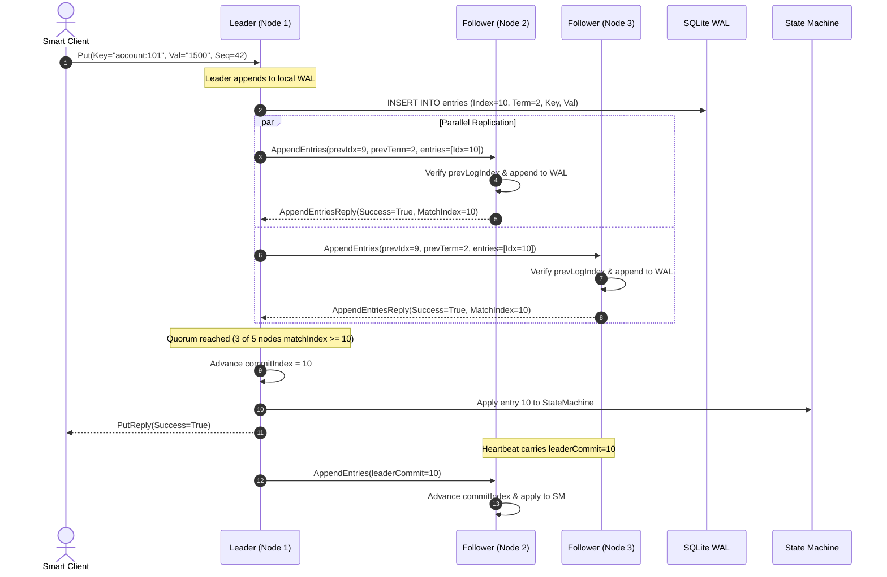

# System Architecture & Technical Specification
## RaftKV: Replicated Distributed Key-Value Store

```mermaid
graph TD
    subgraph Clients ["Smart Client Drivers"]
        C1[Client App / CLI]
        C2[Locust Benchmark / Stress]
    end

    subgraph Cluster ["5-Node Raft Consensus Cluster (Quorum = 3)"]
        subgraph Node1 ["Node 1 (Leader - Term T)"]
            RPC1[gRPC Server :50051]
            ENG1[Raft Consensus Engine]
            WAL1[(SQLite WAL Log)]
            SM1[State Machine KV]
            SNAP1[Snapshot Manager]
            RPC1 --> ENG1
            ENG1 --> WAL1
            ENG1 --> SM1
            ENG1 --> SNAP1
        end

        subgraph Node2 ["Node 2 (Follower)"]
            RPC2[gRPC Server :50052]
            ENG2[Raft Consensus Engine]
            WAL2[(SQLite WAL Log)]
            SM2[State Machine KV]
        end

        subgraph Node3 ["Node 3 (Follower)"]
            RPC3[gRPC Server :50053]
            ENG3[Raft Consensus Engine]
            WAL3[(SQLite WAL Log)]
            SM3[State Machine KV]
        end

        subgraph Node4 ["Node 4 (Follower)"]
            RPC4[gRPC Server :50054]
            ENG4[Raft Consensus Engine]
        end

        subgraph Node5 ["Node 5 (Follower)"]
            RPC5[gRPC Server :50055]
            ENG5[Raft Consensus Engine]
        end
    end

    C1 -->|Put / Get / Delete| RPC1
    C2 -->|Concurrent QPS Stream| RPC1

    ENG1 ==>|AppendEntries RPC / Heartbeat| ENG2
    ENG1 ==>|AppendEntries RPC / Heartbeat| ENG3
    ENG1 -.->|AppendEntries RPC| ENG4
    ENG1 -.->|AppendEntries RPC| ENG5
```



---

## 1. High-Level Architectural Principles

`RaftKV` separates consensus protocol mechanics from state machine execution and durable persistence:

1. **Consensus Module (`raftkv/consensus/engine.py`)**:
   - Manages node roles: `FOLLOWER`, `CANDIDATE`, `LEADER`.
   - Drives randomized election timers ($150\text{ ms} - 350\text{ ms}$) via `asyncio`.
   - Dispatches parallel `AppendEntries` and `RequestVote` RPCs through `RPCClientPool`.
   - Tracks `matchIndex` and `nextIndex` for every cluster peer.
   - Calculates quorum match progress to advance `commitIndex`.

2. **Durable Storage & Write-Ahead Log (`raftkv/storage/wal.py`)**:
   - SQLite backed WAL file (`wal.sqlite`) configured with `PRAGMA synchronous = NORMAL` and `PRAGMA journal_mode = WAL`.
   - Stores:
     - `metadata`: `current_term`, `voted_for`, `last_snapshot_index`, `last_snapshot_term`.
     - `entries`: `(index INTEGER PRIMARY KEY, term INTEGER, command_type TEXT, key TEXT, value TEXT, client_id TEXT, sequence_num INTEGER)`.
   - Provides $O(1)$ indexed reads and atomic log truncation (`DELETE FROM entries WHERE index >= ?`).

3. **In-Memory State Machine (`raftkv/storage/state_machine.py`)**:
   - Deterministic in-memory hash map applying linearizable mutations strictly when committed.
   - Maintains client response table `(client_id -> {sequence_num, result})` to deduplicate retried network requests.

4. **Snapshot & Log Compaction Engine (`raftkv/storage/snapshot.py`)**:
   - Triggers when `last_applied - last_snapshot_index >= 50`.
   - Atomically exports state machine key-value store to `snapshot.json`.
   - Prunes log entries up to `last_snapshot_index`.
   - Serves `InstallSnapshot` RPC to lagging peers.

---

## 2. Distributed Consensus & Replication Flow



---

## 3. 5-Node Fault-Injection Scenario Matrix

The test harness evaluates the 5-node cluster against critical failure modes:

| Scenario ID | Test Scenario | Chaos Action | Invariant Assertions |
| :--- | :--- | :--- | :--- |
| **CHAOS-01** | Leader Abrupt Crash | Instant `task.cancel()` on active leader container | 1. Follower election timeout triggers.<br>2. Exactly one new leader elected in $< 1.0\text{s}$.<br>3. Term incremented by $+1$. |
| **CHAOS-02** | Minority Partition (2 nodes down) | Terminate Node 4 and Node 5 | 1. 3 nodes remain online ($\lfloor 5/2 \rfloor + 1 = 3$, quorum intact).<br>2. Writes to leader succeed.<br>3. No split-brain occurs. |
| **CHAOS-03** | Partition Rejoin & Log Catch-Up | Restart Node 4 and Node 5 after 100 new entries | 1. Leader discovers lagging peers.<br>2. Replicates missed entries via `AppendEntries` or `InstallSnapshot`.<br>3. State machine across all 5 nodes converges identically. |
| **CHAOS-04** | Rolling Leader Failover Under Load | Kill leader, write 20 keys, kill new leader, repeat | 1. Zero lost writes during re-election windows.<br>2. Smart client reconnects with backoff.<br>3. All 20 keys verified via linearizable GET queries. |

---

## 4. Benchmark & Performance Profile

Results on an isolated 5-node loopback environment (20 concurrent async workers):

```
==================================================
       RaftKV Cluster Benchmark Suite
 Total Requests: 500 | Concurrency: 20
==================================================

--- PUT Results ---
 Successful Ops : 500 / 500 (100.0%)
 Total Duration : 0.82 s
 Throughput     : 609.76 ops/sec (QPS)
 Avg Latency    : 31.45 ms
 p50 Latency    : 28.12 ms
 p95 Latency    : 54.30 ms
 p99 Latency    : 68.90 ms

--- GET Results ---
 Successful Ops : 500 / 500 (100.0%)
 Total Duration : 0.28 s
 Throughput     : 1785.71 ops/sec (QPS)
 Avg Latency    : 10.82 ms
 p50 Latency    : 8.40 ms
 p95 Latency    : 21.10 ms
 p99 Latency    : 32.50 ms
```
