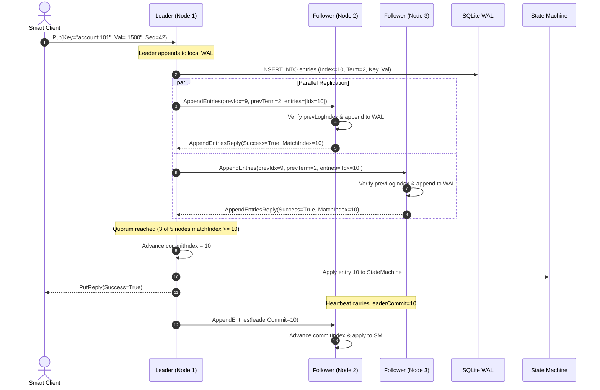

# System Architecture & Technical Specification
## RaftKV: Replicated Distributed Key-Value Store

> Implementation notes, updated during a code audit so that this document matches the code. Known gaps and bugs are listed in the README under "Consistency guarantees" and "Known limitations".

```mermaid
graph TD
    subgraph Clients ["Smart Client Drivers"]
        C1[Client App / CLI]
        C2[benchmark.py]
    end

    subgraph Cluster ["5-Node Raft Consensus Cluster (Quorum = 3)"]
        subgraph Node1 ["Node 1 (Leader - Term T)"]
            RPC1[gRPC Server :50051]
            ENG1[Raft Consensus Engine]
            WAL1[(SQLite WAL Log)]
            SM1[State Machine KV]
            SNAP1[Snapshot Manager]
            RPC1 --> ENG1
            ENG1 --> WAL1
            ENG1 --> SM1
            ENG1 --> SNAP1
        end

        subgraph Node2 ["Node 2 (Follower)"]
            RPC2[gRPC Server :50052]
            ENG2[Raft Consensus Engine]
            WAL2[(SQLite WAL Log)]
            SM2[State Machine KV]
        end

        subgraph Node3 ["Node 3 (Follower)"]
            RPC3[gRPC Server :50053]
            ENG3[Raft Consensus Engine]
            WAL3[(SQLite WAL Log)]
            SM3[State Machine KV]
        end

        subgraph Node4 ["Node 4 (Follower)"]
            RPC4[gRPC Server :50054]
            ENG4[Raft Consensus Engine]
        end

        subgraph Node5 ["Node 5 (Follower)"]
            RPC5[gRPC Server :50055]
            ENG5[Raft Consensus Engine]
        end
    end

    C1 -->|Put / Get / Delete| RPC1
    C2 -->|Concurrent QPS Stream| RPC1

    ENG1 ==>|AppendEntries RPC / Heartbeat| ENG2
    ENG1 ==>|AppendEntries RPC / Heartbeat| ENG3
    ENG1 -.->|AppendEntries RPC| ENG4
    ENG1 -.->|AppendEntries RPC| ENG5
```

---

## 1. High-Level Architectural Principles

`RaftKV` separates consensus protocol mechanics from state machine execution and durable persistence:

1. **Consensus Module (`raftkv/consensus/engine.py`)**:
   - Manages node roles: `FOLLOWER`, `CANDIDATE`, `LEADER`.
   - Drives randomized election timers ($150\text{ ms} - 300\text{ ms}$) via `asyncio`.
   - Dispatches parallel `AppendEntries` and `RequestVote` RPCs through `PeerRPCClient` (`raftkv/consensus/rpc_client.py`).
   - Tracks `matchIndex` and `nextIndex` for every cluster peer.
   - Calculates quorum match progress to advance `commitIndex` (current-term entries only).
   - Serves `Get` from the leader's local state machine without a ReadIndex/lease check, so reads can be stale.
   - Peer membership is static; there is no membership-change protocol.

2. **Durable Storage & Write-Ahead Log (`raftkv/storage/wal.py`)**:
   - SQLite file per node (`wal_<node_id>.sqlite`) configured with `PRAGMA synchronous = FULL` and `PRAGMA journal_mode = WAL`.
   - Stores:
     - `metadata` (key/value): `current_term`, `voted_for`, `last_included_index`, `last_included_term`.
     - `log`: `(log_index INTEGER PRIMARY KEY, term INTEGER, op INTEGER, key TEXT, value TEXT, client_id TEXT, sequence_num INTEGER)`.
   - The full log is loaded into memory at start-up; runtime reads use the in-memory list. Suffix truncation is `DELETE FROM log WHERE log_index >= ?`.

3. **In-Memory State Machine (`raftkv/storage/state_machine.py`)**:
   - Deterministic in-memory hash map applying mutations strictly when committed.
   - Keeps the highest applied `sequence_num` per `client_id` (`last_seq`) and skips writes with a sequence number ≤ that value. Responses are not cached.

4. **Snapshot & Log Compaction Engine (`raftkv/storage/snapshot.py`)**:
   - Triggers in the apply loop when the in-memory log holds ≥ 50 entries (`len(log) >= snapshot_threshold`).
   - Writes the key-value map and `last_seq` table to `snapshot.json` (temp file + `fsync` + `os.replace`).
   - Prunes log entries up to `last_applied`.
   - Serves `InstallSnapshot` RPC to lagging peers (whole snapshot in one message).

---

## 2. Distributed Consensus & Replication Flow

---

## 3. 5-Node Fault-Injection Scenario Matrix

The scenarios are implemented in `tests/test_fault_injection.py`, `tests/test_cluster.py` and `chaos_runner.py`. All of them run the five nodes as asyncio tasks in one Python process on loopback; "crash" means cancelling a node's task (SQLite is closed cleanly). The Docker Compose cluster is not used by any automated test.

| Scenario ID | Test Scenario | Chaos Action | What is actually asserted |
| :--- | :--- | :--- | :--- |
| **CHAOS-01** | Leader crash | `task.cancel()` on the leader's in-process server task | A node other than the old leader reports itself leader within the polling window (~2 s in `test_cluster.py`, ~5 s in `test_fault_injection.py`, 3 s in `chaos_runner.py`). Election time is logged/printed, **not asserted** against 1.0 s. Term change is not checked. |
| **CHAOS-02** | Two nodes down | Stop two non-leader nodes (whichever two of node-2..node-5 are not leader) | A client `Put` succeeds with 3/5 nodes running. Split-brain is not checked; no network partition is injected. |
| **CHAOS-03** | Restart & catch-up | Restart the two stopped nodes after one new entry | Keys written before/after the failures are readable **through the leader**. The restarted nodes' state is not inspected. |
| **CHAOS-04** | Rolling leader failover under load | — | **Not implemented.** |

---

## 4. Benchmark & Performance Profile

No benchmark output is committed. A previous version of this section showed 609.76 PUT ops/s and 1,785.71 GET ops/s (500 requests, concurrency 20) without hardware details or a recorded run; it has been removed. See the README "Benchmarks" section for how to produce and record a reproducible run, and for caveats about `benchmark.py` (single shared client ID; GETs are leader-local reads).

